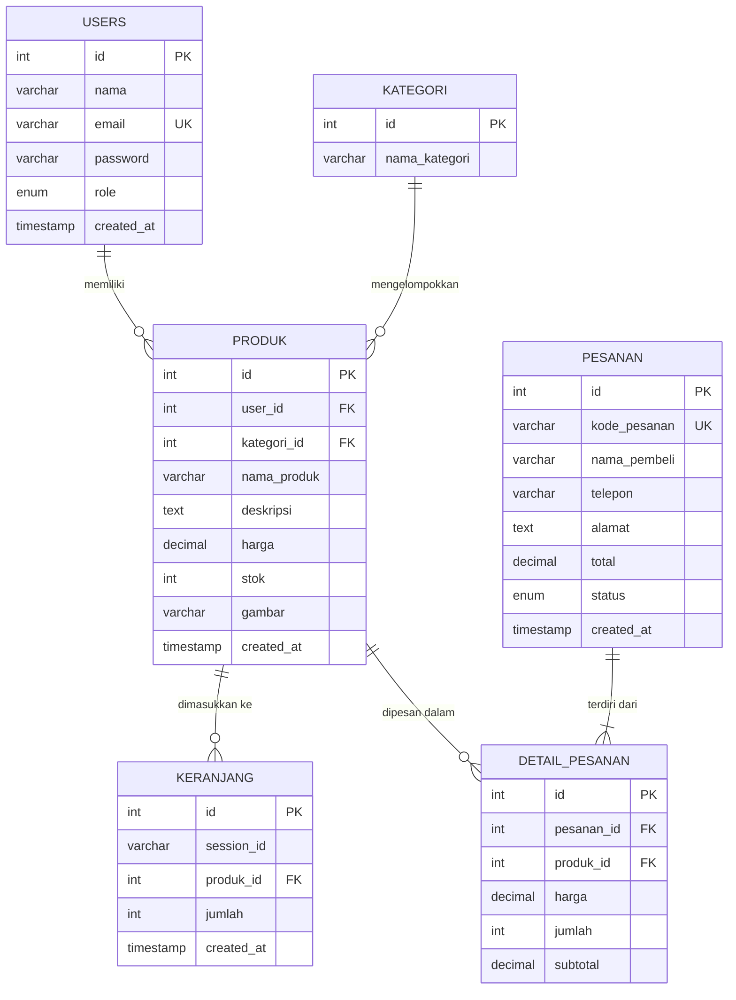
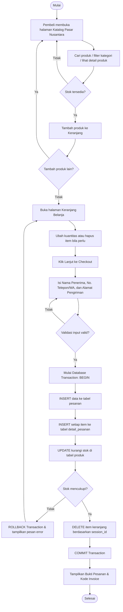

# Dokumen Perancangan — Pasar Nusantara (Web Marketplace Tradisional)

## Informasi Pengumpulan
- **Nama Aplikasi**: Pasar Nusantara — Web Marketplace Tradisional
- **Teknologi**: PHP Native, MySQLi (Database Transaction & Prepared Statements), Bootstrap 5.3, Bootstrap Icons
- **URL Demo (InfinityFree)**: `https://________________.infinityfreeapp.com` *(isi dengan URL subdomain InfinityFree Anda)*
- **URL Repository GitHub**: `https://github.com/Pratama12340/marketplace`

---

## A.a Identifikasi Entitas

| No | Entitas | Keterangan |
|----|---------|------------|
| 1 | `users` | Penjual/admin yang mengelola katalog produk dan status pesanan |
| 2 | `kategori` | Pengelompokan produk (*Sayur & Buah*, *Makanan & Jajanan*, *Kerajinan*, *Pakaian*) |
| 3 | `produk` | Barang dagangan yang dijual oleh penjual beserta harga, stok, dan gambar |
| 4 | `keranjang` | Produk yang dipilih pembeli sebelum checkout (disimpan berdasarkan `session_id`) |
| 5 | `pesanan` | Header transaksi pembelian (kode pesanan unik, identitas pembeli, alamat, total, status) |
| 6 | `detail_pesanan` | Rincian item produk, harga saat transaksi, kuantitas, dan subtotal pada tiap pesanan |

---

## A.b Rancangan Database Relasional

### Struktur Tabel
1. **`users`**: `id` (PK, INT, AI), `nama` (VARCHAR 100), `email` (VARCHAR 100, UNIQUE), `password` (VARCHAR 255, Bcrypt Hash), `role` (`enum('admin','penjual')`), `created_at` (TIMESTAMP)
2. **`kategori`**: `id` (PK, INT, AI), `nama_kategori` (VARCHAR 100)
3. **`produk`**: `id` (PK, INT, AI), `user_id` (FK → `users.id`), `kategori_id` (FK → `kategori.id`), `nama_produk` (VARCHAR 150), `deskripsi` (TEXT), `harga` (DECIMAL 12,2), `stok` (INT), `gambar` (VARCHAR 255), `created_at` (TIMESTAMP)
4. **`keranjang`**: `id` (PK, INT, AI), `session_id` (VARCHAR 64), `produk_id` (FK → `produk.id`), `jumlah` (INT), `created_at` (TIMESTAMP)
5. **`pesanan`**: `id` (PK, INT, AI), `kode_pesanan` (VARCHAR 20, UNIQUE), `nama_pembeli` (VARCHAR 100), `telepon` (VARCHAR 20), `alamat` (TEXT), `total` (DECIMAL 12,2), `status` (`enum('baru','diproses','selesai','batal')`), `created_at` (TIMESTAMP)
6. **`detail_pesanan`**: `id` (PK, INT, AI), `pesanan_id` (FK → `pesanan.id`), `produk_id` (FK → `produk.id`), `harga` (DECIMAL 12,2), `jumlah` (INT), `subtotal` (DECIMAL 12,2)

### Relasi Antar Tabel
| Relasi | Kardinalitas | Keterangan |
|--------|--------------|------------|
| `users` — `produk` | 1 : N | Satu penjual dapat mengelola banyak produk |
| `kategori` — `produk` | 1 : N | Satu kategori mengelompokkan banyak produk |
| `produk` — `keranjang` | 1 : N | Satu produk dapat dimasukkan ke banyak sesi keranjang |
| `pesanan` — `detail_pesanan` | 1 : N | Satu pesanan memiliki satu atau banyak rincian item |
| `produk` — `detail_pesanan` | 1 : N | Satu produk dapat tercatat di banyak riwayat detail pesanan |

> **Catatan Desain**: Atribut `harga` pada tabel `detail_pesanan` disimpan sebagai salinan harga pada saat checkout berlangsung, sehingga apabila penjual mengubah harga produk di kemudian hari, histori nilai transaksi lama tetap akurat.

---

## A.c Entity Relationship Diagram (ERD)



---

## A.d Alur Proses Transaksi (Flowchart)



---

## A.e Mockup Antarmuka Pengguna (UI)

### 1. Halaman Utama / Katalog Produk (`index.php`)
```
+----------------------------------------------------------------------------+
| [🏪] Pasar Nusantara                          [🧺 Keranjang (2)] [Login]   |
+----------------------------------------------------------------------------+
|  HERO BANNER: Belanja Segar & Hemat di Pasar Nusantara                     |
|  [ 🔍 Cari cabai, keripik, batik...     | Semua Kategori v | [   Cari   ] ]|
+----------------------------------------------------------------------------+
|  ( Semua Produk ) ( Sayur & Buah ) ( Makanan & Jajanan ) ( Kerajinan ) ... |
|                                                                            |
|  +----------------+  +----------------+  +----------------+  +-----------+ |
|  | [Sayur] [Stok] |  | [Jajanan][Stok]|  | [Kriya] [Stok] |  | [Pakaian] | |
|  |   [Ilustrasi   |  |   [Ilustrasi   |  |   [Ilustrasi   |  | [Ilustrasi| |
|  |     Cabai]     |  |    Keripik]    |  |   Tas Pandan]  |  |   Batik]  | |
|  | Cabai Merah 1Kg|  | Keripik 250 gr |  | Tas Anyaman    |  | Kain Batik| |
|  | Rp 45.000      |  | Rp 15.000      |  | Rp 85.000      |  | Rp 250.000| |
|  | [Detail] [🛒+] |  | [Detail] [🛒+] |  | [Detail] [🛒+] |  | [Detail]  | |
|  +----------------+  +----------------+  +----------------+  +-----------+ |
+----------------------------------------------------------------------------+
```

### 2. Halaman Detail Produk (`produk.php`)
```
+----------------------------------------------------------------------------+
| Beranda > Sayur & Buah > Cabai Merah 1 Kg                                  |
+----------------------------------------------------------------------------+
| +--------------------------+  [Sayur & Buah]  [Tersedia: 50 stok]          |
| |                          |  Cabai Merah 1 Kg                             |
| |     [ Gambar Produk      |  Rp 45.000                                    |
| |       Cabai Merah ]      |  Dijual oleh: Admin Pasar (Terverifikasi)     |
| |                          |  Deskripsi: Cabai merah segar langsung dari   |
| |                          |  petani lokal dengan kualitas pilihan...      |
| +--------------------------+  Jumlah: [ 1 ] [🛒 Tambah ke Keranjang]       |
+----------------------------------------------------------------------------+
```

### 3. Halaman Keranjang & Ringkasan Belanja (`keranjang.php`)
```
+----------------------------------------------------------------------------+
| 🧺 Keranjang Belanja                                 [+ Tambah Produk Lain]|
+--------------------------------------------------+-------------------------+
| Produk               Harga     Jumlah   Subtotal | Ringkasan Belanja       |
| ------------------------------------------------ | ----------------------- |
| [img] Cabai 1 Kg     Rp45.000  [2][✓]   Rp90.000 | Total Jenis: 2 produk   |
| [img] Keripik 250gr  Rp15.000  [1][✓]   Rp15.000 | Total: Rp 105.000       |
|                                                  | [ Lanjut ke Checkout ]  |
+--------------------------------------------------+-------------------------+
```

### 4. Halaman Checkout & Bukti Pesanan (`checkout.php` & `sukses.php`)
```
+--------------------------------------------------+-------------------------+
| Informasi Penerima                               | Ringkasan Pesanan       |
| Nama Lengkap : [ Budi Santoso                  ] | Cabai 1 Kg x2  Rp90.000 |
| No. Telepon  : [ 081234567890                  ] | Keripik x1     Rp15.000 |
| Alamat       : [ Jl. Merdeka No. 10...         ] | ----------------------- |
| [<- Kembali]        [Konfirmasi & Buat Pesanan]  | Total Tagihan Rp105.000 |
+--------------------------------------------------+-------------------------+
```

### 5. Dashboard Penjual (`admin/produk.php` & `admin/pesanan.php`)
```
+----------------------------------------------------------------------------+
| [🏪] Pasar Nusantara     [Lihat Katalog] [Kelola Produk] [Pesanan] [Logout]|
+----------------------------------------------------------------------------+
| 📦 Kelola Katalog Produk                            [+ Tambah Produk Baru] |
| +---+----------------------+-------------------+-----------+--------+----+ |
| | # | Produk               | Kategori          | Harga     | Stok   |Aksi| |
| +---+----------------------+-------------------+-----------+--------+----+ |
| | 4 | [img] Kain Batik 2 m | Pakaian           | Rp250.000 | 10 unit|Edit| |
| | 3 | [img] Tas Anyaman    | Kerajinan         | Rp 85.000 | 20 unit|Edit| |
| | 2 | [img] Keripik 250 gr | Makanan & Jajanan | Rp 15.000 |100 unit|Edit| |
| | 1 | [img] Cabai Merah 1Kg| Sayur & Buah      | Rp 45.000 | 50 unit|Edit| |
| +---+----------------------+-------------------+-----------+--------+----+ |
+----------------------------------------------------------------------------+
```
